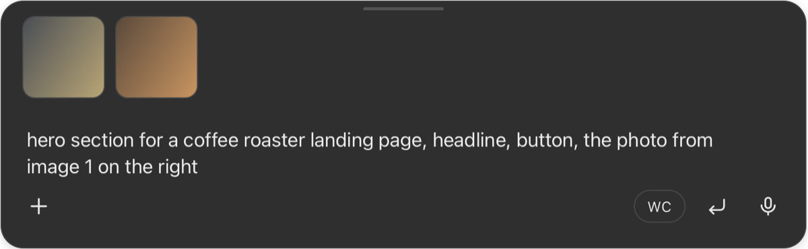
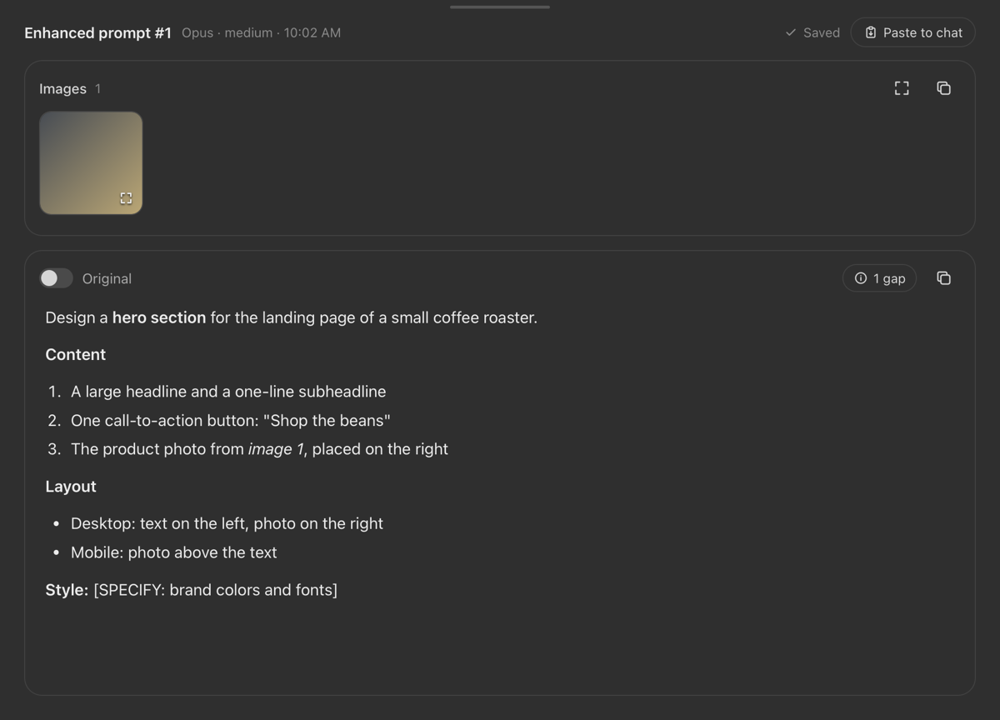

<p align="center">
  
</p>

<h1 align="center">Enhance Prompt for Claude</h1>

<p align="center">
  <b>A <code>/enhance-prompt</code> command for Claude Code on the Mac.</b><br>
  Write a rough prompt, add images or dictate it. Claude rewrites it the way an expert would, without adding anything you didn't say.
</p>

<p align="center">
  
  
  
  
</p>

<p align="center">
  <a href="#install"><b>Install</b></a> ·
  <a href="#how-to-use-it">How to use it</a> ·
  <a href="#dictation">Dictation</a> ·
  <a href="#permissions">Permissions</a> ·
  <a href="#privacy">Privacy</a> ·
  <a href="#faq">FAQ</a>
</p>

<p align="center">
  
</p>

> [!NOTE]
> Enhance Prompt for Claude is an independent, open-source project. It is not made by,
> affiliated with, or endorsed by Anthropic. "Claude" is a trademark of Anthropic.

## Why

A good prompt gets a much better answer, but writing one takes time. Most of the time you know
*what* you want and type it quickly: half a sentence, a list, "the button in image 2".

`/enhance-prompt` opens a small window over your screen. You write (or dictate) the rough version,
add screenshots if you want, and send it. Claude rewrites it the way an expert in that field would
write it: clear structure, the right words, precise requirements. It **does not invent anything**:
no new features, no guessed details. When something important is missing, it leaves a marked gap
like `[SPECIFY: target audience]` and asks you about it.

## What you get

**The prompt popup**
- A text box with formatting: lists (`- ` or `1. `), **bold** and *italic* (⌘B / ⌘I), links, `---` lines, and Tab to nest lists.
- Images: paste, drop or add them, then mark them up (boxes, circles, arrows, pen, text, crop) in a full-screen editor.
- **Revise**: pick an earlier enhanced prompt from the same conversation and say what to change.
- **WC** (with conversation): lets Claude read the last messages of your chat, only to understand what you point at ("the bug above").
- **Mic**: dictate with Mac dictation, Parakeet V3 or Whisper (see [Dictation](#dictation)). Hold the mic for languages and settings.
- A handle at the top to move it anywhere on the screen. ⌘↵ sends, Esc closes (your draft is kept).

**The result window**

<p align="center">
  
</p>

- The enhanced prompt, formatted, and editable (with its own undo). Edits are saved.
- **Original** switch to compare with your draft, a list of what changed, and the gaps to fill.
- **Paste to chat** pastes the prompt into the Claude desktop app for you. There are copy buttons too.
- Drag the handle to move it; double-click it to fill the screen.

**The right model for the job.** A quick Sonnet router reads the draft. Simple everyday drafts
(a short message, an email) it rewrites itself. Prompts about code, design, web pages, or image and
video generation go to Opus, at high effort when they are complex. Add `--opus` to always use Opus (high).

## Install

You need a Mac with macOS 13 or later, [Claude Code](https://code.claude.com/docs/en/overview),
and Apple's Command Line Tools (`xcode-select --install`).

```bash
git clone https://github.com/BPDRED/enhance-prompt-for-claude.git
cd enhance-prompt-for-claude
./install.sh
```

The installer:
1. copies the skill to `~/.claude/skills/enhance-prompt`,
2. builds the small helper app on your Mac (`EnhancePrompt.app`, with its icon),
3. writes the three agents it uses to `~/.claude/agents`.

To update, pull and run `./install.sh` again (close any Enhance Prompt window first). To remove it, run
`./uninstall.sh`. Your saved prompts and the optional speech engine (`~/.claude/prompt-enhancer-engine`)
stay until you delete them.

Tested on an Intel Mac with macOS 15 and the Claude desktop app. Apple Silicon should work the same
(the app is built on your Mac for your Mac), but it hasn't been tested yet.

## How to use it

In Claude Code, type:

```
/enhance-prompt
```

The popup opens. Write your draft, add images if you want, and press **⌘↵** (or the send button).
A few seconds later the result window opens with the enhanced prompt. Click **Paste to chat** or copy it.

You can also start with text: `/enhance-prompt fix the login page on small screens`.
The command is manual only: Claude never runs it by itself.

## Dictation

Click the mic to start and stop. Hold it (half a second) to pick a language or open the settings.

| Engine | Quality | Speed | Setup |
| --- | --- | --- | --- |
| **Mac dictation** | Good | Live, while you speak | Built in. The mic turns green while it listens. |
| **Parakeet V3** (Handy's engine) | Best | About 5 s after you stop | After installing, run `~/.claude/skills/enhance-prompt/engine/build-parakeet.sh` (needs `cmake` and `git`; downloads the model). |
| **Whisper Turbo** | Very good | Slower (10–20 s on older Macs) | `brew install whisper-cpp`, then put `ggml-large-v3-turbo-q5_0.bin` in `~/.cache/whisper.cpp/`. |

Engines that aren't set up show as "Not installed" in the settings.

## Permissions

macOS asks the first time you use each of these:

- **Microphone** and **Speech Recognition**: only for dictation.
- **Accessibility**: only for **Paste to chat** (it brings the Claude desktop app forward and presses ⌘V for you).
  Add it in *System Settings › Privacy & Security › Accessibility*. The app is in
  `~/.claude/skills/enhance-prompt/build`. In the **+** file window, press **⌘⇧G** and paste that path.

After an update the app is rebuilt, so macOS may ask again.

## Privacy

- Your drafts and results stay on your Mac, in `~/.claude/prompt-enhancer`
  (one folder per conversation; folders unused for 30 days are deleted).
- The prompt is enhanced by Claude through your own Claude Code, like any other message.
- The helper app makes no network requests of its own. Mac dictation uses Apple's speech
  recognition; Parakeet and Whisper run on your Mac.
- Conversation messages are read only when **WC** is on.

## FAQ

**Does it change my prompt's meaning?**
It shouldn't. The rules forbid adding requirements, details or examples you didn't give. Missing
pieces become `[SPECIFY: …]` placeholders and questions, never guesses.

**Where do I change how it rewrites prompts?**
Edit `~/.claude/skills/enhance-prompt/INSTRUCTIONS.md`, then run
`python3 ~/.claude/skills/enhance-prompt/bin/make-agents.py`.

**Can I test the pages without the app?**
Yes: run `python3 -m http.server` in `skill/ui` and open `popup.html?mock` or `result.html?mock`.

## Credits

- Parakeet V3 runs on [transcribe.cpp](https://github.com/handy-computer/transcribe.cpp) by the
  [Handy](https://github.com/cjpais/Handy) project (MIT license, see `skill/engine/LICENSE-transcribe.cpp.txt`).
- Whisper Turbo runs on [whisper.cpp](https://github.com/ggml-org/whisper.cpp).

## License

[MIT](LICENSE)
